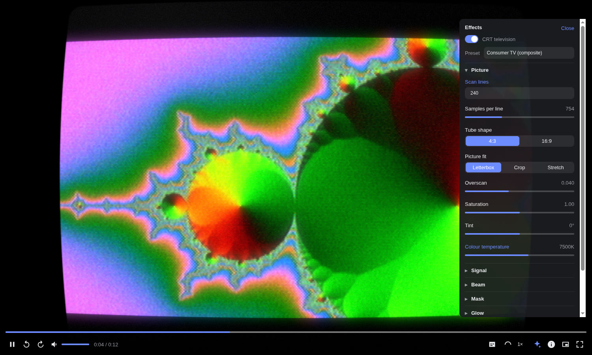
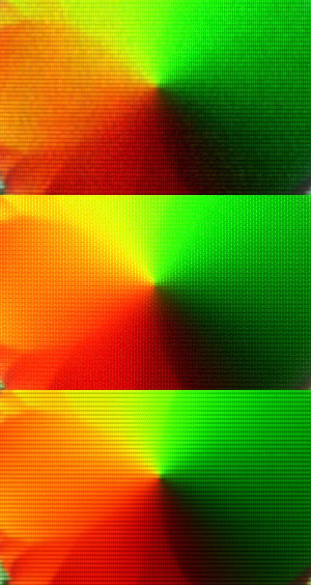

# Shader Video Player

A desktop video player that plays your files through real-time shader effects. The first effect is a physically inspired **CRT television**: scanline beams, phosphor masks, glow, tube curvature and analog composite/S-Video signal artefacts, with presets and a control for every parameter. A VHS effect is planned next.

Built on Electron, React and WebGL2. Linux (Wayland/X11) is the supported platform for now.

> Status: early development. Everything below works, but the presets were tuned on test patterns and still need a pass against real footage. See [Known limitations](#known-limitations).



<details><summary>Close-up of three presets (Trinitron, Arcade, PVM)</summary>



</details>

## Features

- Plays MP4, MKV, WebM, MOV, AVI and more. Formats Chromium cannot decode (HEVC, AC3/DTS audio, AVI…) are converted on the fly with ffmpeg.
- Open dialog, drag and drop, an Open Recent menu, resume position, playback speed, audio track selection, fullscreen, picture-in-picture, and a remaining-time toggle.
- Opens only real video files: images, playlists and network formats are refused.
- Play queue: open or drop several files (Ctrl+Shift+O, or Shift+drop, adds to the queue), next/previous, auto-advance, and loop off / all / one.
- Top bar with the file name and queue position. Ctrl+W or the top-bar back button returns to the home screen.
- End screen when the queue finishes: Replay, Play queue again, or Back to home.
- Screenshots (`S` or Ctrl+Shift+S) save the current frame, with the active effect applied, as a PNG.
- Subtitles: embedded tracks plus external `.srt`, `.vtt`, `.ass` files (a file named like the video is picked up automatically). Subtitles are drawn above the effect so they stay sharp, with a text size control and a timing delay.
- Shortcut overlay: press `?` for the full list of keys.
- Keyboard-accessible sliders, menus and panels; `Escape` closes whatever overlay is open.
- CRT effect with four presets: Consumer TV (composite), Trinitron (S-Video), Arcade monitor (RGB), Broadcast monitor (PVM), and a settings panel with a control for each of its ~50 parameters. Settings are remembered between runs.
- Effects can be switched off instantly; with no effect active the video plays through the normal, low-power path.

## Requirements

- Node 24 and pnpm
- `ffmpeg` and `ffprobe` on your `PATH` (`sudo apt install ffmpeg`)
- A GPU with WebGL2 and floating-point render targets (any reasonably recent GPU; without them the CRT effect switches itself off with a message)

## Getting started

```bash
pnpm install
pnpm dev                 # run in development
pnpm dist                # build a .deb into release/
sudo apt install "./release/Shader Video Player-0.1.0-amd64.deb"
```

In development Electron is started with `--no-sandbox`, because the sandbox helper installed by the package manager is not setuid. The packaged `.deb` runs sandboxed.

### Keyboard shortcuts

Every shortcut is declared once in [`shared/commands.ts`](shared/commands.ts). Press `?` in the app to see the same list.

| Group | Command | Keys (Linux / Windows) |
|---|---|---|
| File | Open… | Ctrl+O |
| | Add to Queue… | Ctrl+Shift+O |
| | Close | Ctrl+W |
| | Screenshot | S, Ctrl+Shift+S |
| Playback | Play / Pause | Space |
| | Back 5 seconds | ← |
| | Forward 5 seconds | → |
| | Back 30 seconds | Shift+← |
| | Forward 30 seconds | Shift+→ |
| | Volume up | ↑ |
| | Volume down | ↓ |
| | Mute | M |
| | Slower | [ |
| | Faster | ] |
| | Previous | P |
| | Next | N |
| | Cycle loop mode | L |
| | Show remaining time | T |
| Subtitles | Subtitles earlier | G |
| | Subtitles later | H |
| Effects | Toggle effect | E |
| | Effects panel | Shift+E |
| View | Fullscreen | F |
| | Info | I |
| | Keyboard shortcuts | ? |

Shift+drop adds dropped files to the queue. Load Subtitle… and Picture in picture have no keyboard shortcut; use the menu or the controls.

On macOS the same shortcuts use ⌘ in place of Ctrl (Ctrl+O is ⌘O) and ⇧ in place of Shift. Linux is the supported platform.

Other commands: `pnpm typecheck`, `pnpm test`, `pnpm build`, and `pnpm check:shaders`, which compiles every shader pass on your GPU in a hidden window.

Environment variables:

| Variable | Purpose |
|---|---|
| `SVP_FFMPEG_PATH`, `SVP_FFPROBE_PATH` | Use specific ffmpeg/ffprobe binaries instead of the ones on `PATH` |
| `SVP_NO_HWDEC=1` | Disable the hardware video decode switches |

## How the CRT effect works

The video is not simply overlaid with lines. Each frame goes through a chain of shader passes:

1. **Raster** — the picture is resampled onto the tube's raster (240–576 scan lines), with overscan and colour controls.
2. **Signal** — the raster is carried over a simulated RGB, S-Video or composite connection. Composite modulates colour onto a subcarrier and decodes it again, which is what produces colour bleed, dot crawl and rainbowing.
3. **Linearize + persistence** — tube gamma, then phosphor afterglow from the previous frame.
4. **Glow and diffusion** — light spreading in and through the glass.
5. **Tube** — at full screen resolution: curvature, convergence, a per-channel electron beam whose width grows with brightness, the phosphor mask (aperture grille, slot or shadow mask) locked to your display's pixels, brightness compensation, vignette, reflection and noise.

Only the last step runs at screen resolution; the rest work on the small raster, which keeps the effect affordable. Scanlines fade out automatically when the window is too small to show them cleanly (below about 2.5 screen pixels per line), so they are most visible at 1080p and above.

Every parameter is declared once in `renderer/shader/effects/crt/params.ts`; the settings panel, shader uniforms, presets and saved settings are all generated from that table.

## Project layout

```
electron/                  main process: windows, IPC, local-file protocol, play queue
electron/media/            ffprobe, ffmpeg transcode sessions, subtitle conversion
renderer/                  React UI (components, hooks, styles)
renderer/shader/gl/        small WebGL2 multi-pass engine
renderer/shader/glsl/      shared GLSL chunks
renderer/shader/effects/   effect definitions (crt/)
shared/                    types and helpers shared by both processes
tests/                     unit tests and the shader compile check
scripts/                   dev, build and shader-check scripts
docs/superpowers/specs/    design documents
```

See `CLAUDE.md` for the conventions used in this codebase, the security model and how to verify rendering from the command line.

## Known limitations

- Linux only for now; no Windows or macOS builds.
- SDR output only. HDR files play, but tone-mapped by the browser engine.
- Drawing through shaders uses more GPU and power than plain playback; 4K performance has not been measured yet.
- Files that need a full video transcode (for example HEVC without hardware decoding) are CPU-heavy, and seeking in them restarts the conversion.
- Image-based subtitles (PGS, VobSub) are not supported, and `.ass` styling is dropped.
- Whether hardware video decoding engages depends on your GPU and drivers; set `SVP_NO_HWDEC=1` if it misbehaves.

## Roadmap

1. Tune the CRT presets against real footage.
2. VHS effect, reusing the analog signal passes.
3. Performance measurements and a quality toggle for integrated GPUs.

## Credits and licence

MIT — see [LICENSE](LICENSE).

The player is based on [babu-video-player](https://github.com/babu-studios/babu-video-player) by Babu Studios (MIT). Shader techniques draw on published work credited in [THIRD_PARTY_NOTICES.md](THIRD_PARTY_NOTICES.md). ffmpeg is used as an external program and is not bundled. The interface typeface, Archivo (SIL Open Font License 1.1), is bundled so the app works offline.
